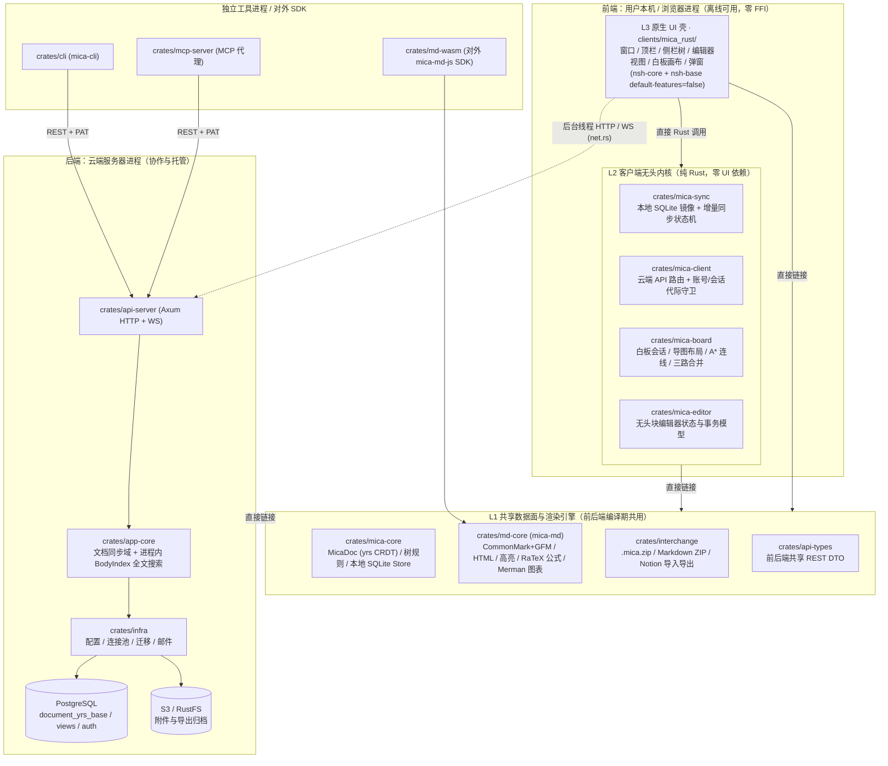

# Mica 系统架构总览

> 最后更新：2026-11-22（全栈纯 Rust 改造落地后重写，取代早期 Flutter + FFI 架构说明）。  
> 本文描述的是**当前仓库的真实运行形态与代码地图**；分阶段演进背景与决策论证见 [`fullstack-rust-architecture.md`](fullstack-rust-architecture.md)，各子系统细则见文末索引。

---

## 1. 一句话分清前端与后端

当前 Mica 已实现 **100% 全栈纯 Rust（零 Dart / Flutter / FFI 桥接）**。因为前后端同为 Rust，不再按“语言”划分前后端，而是按**运行位置（进程边界）**划分：

- **前端（运行在用户本机 / 浏览器中的客户端进程）**：`clients/mica_rust/`（UI 界面壳，L3）直接静态链接 `crates/` 中的客户端无头内核（L2）和共享引擎（L1），**离线本地模式无需任何后端即可独立完整运行**。
- **后端（运行在服务器上的云端服务进程）**：`crates/api-server` + `crates/app-core` + `crates/infra`（Axum HTTP/WS + PostgreSQL + S3/RustFS），只在切到「云端账户」进行多端同步、多人协作、公开分享、云端 AI 时通过 HTTP / WebSocket 交互。
- **共享引擎（L1）**：`mica-core`、`md-core`、`interchange`、`api-types` 等纯 Rust 库，被前端客户端和后端服务器在**编译期直接共用同一份代码**，消除跨语言重复实现与协议漂移。

---

## 2. 全仓库 Crate 与目录地图

| 归属 | 路径 | 职责与边界 | 产物 |
| --- | --- | --- | --- |
| **前端 · UI 壳 (L3)** | `clients/mica_rust/` | 独立 Cargo workspace；基于 `nsh-core` / `nsh-base`（`default-features = false`）与原生平台后端构建桌面与 WASM 界面，直接调用 L1 + L2 Rust API | `mica-rust` 桌面可执行文件 / WASM 客户端 |
| **前端 · 无头内核 (L2)** | `crates/mica-sync` | Sans-I/O 增量同步状态机与本地 SQLite 镜像存储 | Rust 库（静态链接进客户端） |
| **前端 · 无头内核 (L2)** | `crates/mica-client` | 云端端点拼装、登录协议解码、`ClaimTracker` 账号/会话代际守卫 | Rust 库 |
| **前端 · 无头内核 (L2)** | `crates/mica-board` | 无限白板/思维导图图元模型、交互会话 `BoardSession`、自动布局、A* 路由、draw.io/Markdown/SVG 编解码与三路合并 | Rust 库（前后端/渲染共用） |
| **前端 · 无头内核 (L2)** | `crates/mica-editor` | 零 UI 依赖的块编辑器无头状态与命令模型 | Rust 库 |
| **共享引擎 (L1)** | `crates/mica-core` | 唯一 CRDT 文档核心 `MicaDoc`（`yrs`）、`tree_rules`（folder 唯一容器 + 防环）、桌面端 SQLite `LocalStore` | Rust 库（前后端共用） |
| **共享引擎 (L1)** | `crates/md-core` | 唯一 Markdown 引擎（crate `mica-md`）：解析/序列化/HTML/属性/高亮，`render` 特性含 `ratex-*` 公式与 `merman` 图表 | Rust 库（前后端共用） |
| **共享引擎 (L1)** | `crates/markdown` | 服务端 crate 调用 `md-core` 的薄门面，不放语法逻辑 | Rust 库 |
| **共享引擎 (L1)** | `crates/interchange` | 纯逻辑归档导入导出规划（`.mica.zip` 无损备份、Markdown ZIP、Notion ZIP） | Rust 库（前后端共用） |
| **共享引擎 (L1)** | `crates/api-types` | REST 载荷 DTO（crate `mica-api-types`），服务端/CLI/客户端共用一份定义 | Rust 库 |
| **后端 · 云端服务** | `crates/api-server` | Axum HTTP + WebSocket 入口，按域组织在 `src/routes/<域>/`，内嵌 `migrations/` 启动自动迁移 | `mica-api-server` 二进制 |
| **后端 · 云端业务** | `crates/app-core` | 文档/同步领域服务与 `AppState`（进程内 `BodyIndex` 全文搜索、协作房间管理） | Rust 库 |
| **后端 · 基础设施** | `crates/infra` | 环境变量配置、PostgreSQL 连接池、错误映射、邮件发送 | Rust 库 |
| **独立工具 / SDK** | `crates/cli` | `mica-cli` 命令行工具（备份、导出、管理及宿主 `mica-cli mcp`） | `mica-cli` 二进制 |
| **独立工具 / SDK** | `crates/mcp-server` | 给 AI 客户端使用的 MCP 工具面（走 REST + PAT，不直连数据库） | 库（由 `mica-cli mcp` 运行） |
| **独立工具 / SDK** | `crates/md-wasm` | `md-core` 的 `wasm-bindgen` 绑定，对外提供 `packages/mica-md-js` | npm / WASM SDK |

### 前端壳 `clients/mica_rust/src/` 内部模块划分

- **外壳与导航**：`lib.rs`（根状态与全局快捷键）、`mica_theme.rs`（明暗色板与样式 Token）、`mica_icons.rs`（矢量图标）、`app_menu.rs`（左上角应用菜单 / 关于 / 底部堆叠账号菜单）、`world_switcher.rs`（本地 vs 云端多服务器分屏切换）。
- **侧栏与目录树**：`sidebar.rs`（可调宽侧栏、右键菜单、拖拽排序、多选、收藏）、`tree_dnd.rs`（落点规划与防环规则）、`emoji_picker.rs`（双语 Emoji 选择器）、`workspace_views.rs`（工作区设置、成员与概览）。
- **编辑器与扩展块**：`editor_view.rs`（编辑器顶栏、格式栏、选区浮窗、页内查找、字数徽章）、`mica_rich_bridge.rs`（`MicaDoc` CRDT ↔ `RichEditor` 同步与单撤销栈）、`node_views.rs`（无框悬停工具条代码块、公式、图片、GFM Callout、内嵌白板）、`atomic_blocks.rs`（原子块渲染注册表）、`editor_slash.rs`（光标锚定 22 项斜杠菜单）、`page_width.rs`（680–1880px 对称拖拽调宽）、`block_marquee.rs`（正文多块框选）。
- **知识管理与白板**：`right_sidebar.rs`（可调宽大纲/评论侧栏 + 页底反链）、`property_panel.rs`（front-matter 属性面板）、`version_history.rs`（块级 Diff 对比）、`comment_panel.rs`、`share_dialog.rs`、`graph_dialog.rs`（Fruchterman–Reingold 关系图谱）、`ai_dialog.rs`、`search_view.rs`、`settings_view.rs`（1120×840 八标签页）、`board_view.rs`（飞书式无限白板）。
- **本地存储、导入导出与云端传输**：`storage.rs`（SQLite Vault + 偏好持久化）、`transfer.rs` + `transfer_dialog.rs`（`mica-interchange` + 原生文件弹窗）、`net.rs`（云端 HTTP 契约与后台线程执行器 `run_blocking`）。

---

## 3. 核心架构不变量与设计决策

1. **单一真相源（CRDT / Markdown / 树规则）**：
   - 文档内容以 `yrs` CRDT（`mica-core::MicaDoc`）为唯一权威态，块级嵌套保持扁平模型（`data.indent` / `data.quote` / `qbreak` / `data.li`），HTML 导出重建嵌套。
   - Markdown 解析/序列化/HTML/公式/图表只有一份实现（`crates/md-core`，CommonMark 0.31.2 `641/641` + GFM `24/24`，记分牌见 [`commonmark-scoreboard.md`](commonmark-scoreboard.md)），**round-trip 稳定性**为强不变量。
   - **`folder` 是唯一容器，`page` 是叶子**：服务端走 `documents::ensure_parent_accepts_children` + Postgres 触发器 `views_parent_must_be_folder` 兜底；本地客户端通过 `mica_core::tree_rules` 共享同一套判定（含防环）。
2. **渲染扩展走注册表机制**：
   - 编辑器原子块（公式 `ratex`、Mermaid `merman`、内嵌白板 `mica-board`、代码块、图片）统一经 [`clients/mica_rust/src/atomic_blocks.rs`](../../clients/mica_rust/src/atomic_blocks.rs) 与 `node_views.rs` 扩展，禁止向主视图堆条件分支。
   - 列表虚拟化（`virtual_list`）的 `count` 与 `keys` 只订阅结构版本，不订阅正文编辑信号。
3. **客户端非阻塞网络与异步代际守卫**：
   - 所有云端阻塞 HTTP 请求（健康探测、登录/注册、分享、AI 等）一律经 `net::run_blocking` 在后台线程执行，绝不阻塞 UI 事件循环；跨 `await` 回写 UI 状态前按 [`../dev/async-review-checklist.md`](../dev/async-review-checklist.md) 校验代际/归属（如 `probe_gen` / `auth_gen` / `active_doc`）。

---

## 4. 存储、同步、搜索与认证

- **本地世界（离线优先）**：客户端将视图树、CRDT 文档、版本快照、白板 JSON 与偏好直接持久化在本机 SQLite Vault（`storage.rs` + `mica-core::LocalStore`），无账号、无网络依赖。
- **云端存储（PostgreSQL + S3/RustFS）**：
  - 文档状态存在 `document_yrs_base`（`yrs` 状态），增量流存在 `workspace_updates`（按全局 `rid` 排序与滚动裁剪）；自动与命名版本快照均基于 `yrs` 原生存储，恢复版本通过广播新的正向 `sync.update` 完成，从不改写历史日志。
  - 附件与导出归档存放在 S3 兼容对象存储（默认 RustFS），按内容寻址去重。
- **实时协作**：WebSocket 文档房间收发 `yrs` 增量；服务端对**每条消息**校验实时权限（不信任建连缓存），按 `rid` 协议重连补齐（`sync.bootstrap` / `sync.pull` / `sync.push` / `sync.ack`），同连接承载在线感知与光标。
- **全文搜索**：云端采用进程内可锁定内存子串索引 `BodyIndex`（无 Tantivy、无 Redis）提出候选、SQL 做工作区权限与回收站过滤，详见 [`search.md`](search.md)；本地模式直接检索本机工作区树与正文。
- **认证**：云端使用邮箱密码换取短效 JWT + 一次性轮转 Refresh Token（含复用检测），默认关闭公开注册，首账号自动验证；本地模式无认证层。

---

## 5. 工程门禁与部署

- **代码结构门禁**：`just check-structure`（`scripts/check-file-size.sh` + `scripts/check-ignored-sources.sh`）按单文件校验 `crates/*/src` 与 `clients/mica_rust/src` 行数上限及存量增量预算。
- **双 Workspace 验证**：共享 crate 变更须同时验证根 workspace 与独立 workspace `clients/mica_rust`（`cargo clippy --all-targets -- -D warnings` + 单元测试 + `Headless` 端到端测试）。
- **部署**：单节点 Docker Compose（Postgres + RustFS + `api-server` + 反向代理/Traefik），迁移内嵌于 API 二进制并在启动时自动执行；带迁移部署前先生成经校验的还原点。详见 [`../ops/release.md`](../ops/release.md) 与 [`../ops/deploy.md`](../ops/deploy.md)。

---

## 6. 日常改代码去哪找

| 想改的内容 | 对应位置 |
| --- | --- |
| 桌面/Web 界面样式、弹窗、快捷键、交互卡顿 | `clients/mica_rust/src/` |
| 客户端本地 SQLite 存储与偏好 | `clients/mica_rust/src/storage.rs`、`crates/mica-core` |
| 客户端调用云端 HTTP / 后台同步 | `clients/mica_rust/src/net.rs`、`crates/mica-client`、`crates/mica-sync` |
| 无限白板图元、布局与三路合并 | `crates/mica-board`、`clients/mica_rust/src/board_view.rs` |
| Markdown 解析/导出、公式、Mermaid、高亮 | `crates/md-core` |
| `.mica.zip` / Markdown / Notion 导入导出 | `crates/interchange`、`clients/mica_rust/src/transfer.rs` |
| 云端 HTTP/WS 接口、权限、Postgres 迁移 | `crates/api-server`、`crates/app-core`、`crates/infra`、`migrations/` |

---

## 7. 专题文档索引

| 主题 | 文档 |
| --- | --- |
| 全栈 Rust 三层架构演进与设计细则 | [`fullstack-rust-architecture.md`](fullstack-rust-architecture.md) |
| 纯 Rust 客户端 1:1 功能对齐清单 | [`../plans/rust-parity-checklist.md`](../plans/rust-parity-checklist.md) |
| 编辑器设计原则与渲染注册表 | [`editor.md`](editor.md) · [`editor-engine.md`](editor-engine.md) · [`render-architecture.md`](render-architecture.md) |
| 同步与 API 协议 | [`sync-and-api.md`](sync-and-api.md) · [`../dev/api.md`](../dev/api.md) |
| 全文搜索 | [`search.md`](search.md) |
| Markdown 单源引擎与记分牌 | [`../single-source/README.md`](../single-source/README.md) · [`commonmark-scoreboard.md`](commonmark-scoreboard.md) |
| 本地优先与版本历史 | [`local-first-plan.md`](local-first-plan.md) · [`../features/version-history-plan.md`](../features/version-history-plan.md) |
| 异步评审与踩坑记录 | [`../dev/async-review-checklist.md`](../dev/async-review-checklist.md) · [`../dev/lessons.md`](../dev/lessons.md) |
| 发布、部署与容灾 | [`../ops/release.md`](../ops/release.md) · [`../ops/deploy.md`](../ops/deploy.md) |
