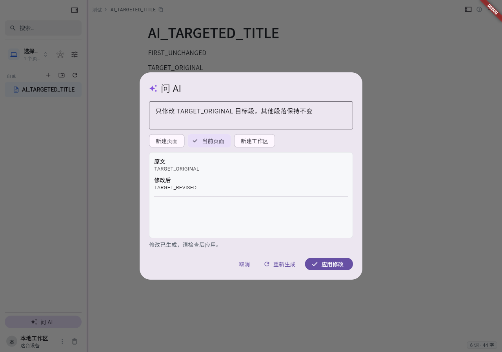

# AI 当前页定向修改

在「问 AI」中选择「当前页面」，可以用自然语言指定正文中的修改目标，例如：

- 只调整 Ansible 这一节的列表与代码块排版，保留其他章节。
- 修正第二个代码块中的变量名，保留说明文字。
- 把这两个重复段落合并成一段。

AI 收到当前编辑器的实时正文、标题和有序块信息，返回目标块 ID 与替换 Markdown。目标可以是单个块、连续多个块，或多个互不重叠的范围。服务端校验目标并用 Rust Markdown 解析器转换替换内容，客户端先展示每个范围的原文与修改后内容。点击「应用修改」后，编辑器在原位置替换对应范围，一次撤销恢复整次 AI 修改。

未涉及的块保留原 ID、内容与属性，也保留生成期间发生的其他编辑。目标块的内容、类型、属性或范围顺序若在生成期间发生变化，整次修改拒绝应用，需要重新生成。切换到其他页面也拒绝旧预览；切换生成目标会清除旧结果。

未知块 ID、不连续或重叠范围、无效 JSON、删除整个页面的计划均拒绝。预览接口只校验请求中提供的内容，不写文档，也不再次调用模型；实际应用使用编辑器现有的操作提交与撤销机制。

嵌套列表及列表子块需要连同外层父项和完整子块一起修改，引用需要包含完整引用组，避免独立解析片段丢失容器关系。生成系统指令包含这些要求，服务端也会拒绝拆开容器的计划。

应用会等待现有操作提交回调完成；回调失败时对话框保留并提示保存未完成。页面中已经显示的修改仍可撤销，不在客户端单独回滚，以免与已经变化的 CRDT 或服务端状态分裂。提交回调完成不等于服务端已确认同步，同步状态仍以现有同步指示为准。

当前范围是正文块替换，不修改独立页面标题，也不提供块内字符级补丁。一个段落内的小改动会返回该段落的完整替换内容，因此应用前应检查预览。模型定位仍可能有误，块 ID 校验保证目标有效，预览用于确认目标是否符合指令。

AI 流只有收到上游提供方的成功终止帧才算完成：OpenAI 的 `[DONE]` 或 Anthropic 的 `message_stop`。提供方 SSE 错误及缺少成功终止帧的断流会显示失败，部分输出不能替换或插入正文；取消或重新生成后旧流也不能改变新预览。客户端断开时，服务端会取消仍在读取的上游流，包括只有注释心跳而没有正文增量的阶段。

此能力从 v0.13.49 开始，需要支持 `/api/ai/edits/preview` 的服务端与新版客户端；本地离线模式沿用现有 AI 可用性限制。服务端升级前不会把结构化修改结果当作正文追加。

## v0.13.49 发布验收（2026-10-12）

发布提交为 `fe2fd74`。[Release](https://github.com/weironz/mica/actions/runs/38205357200)
全部成功，Windows 安装包、三平台 CLI 和三个应用镜像均已产出；GitHub latest 为 v0.13.49。
[Deploy](https://github.com/weironz/mica/actions/runs/38206339629) 的真节点彩排及部署均成功，
api/web/backup 运行 v0.13.49，镜像 digest 与 ACR 发布产物一致。无新数据库迁移，
PostgreSQL 与 RustFS 容器 ID 与部署前一致。

公网 `/api/ready` 返回 `ready`、`version: 0.13.49`、`registration_open: false`。
实际 Web bundle 包含本版版本号、预览接口和块编辑系统指令；公网文件与容器内文件 SHA256 均为
`30e1231b17bc36e59b46ec5fe3ddd8f31684ea0e6938a3291154bb12f4483359`。

本地 `just release 0.13.49` 完整门禁通过，包括真实 Postgres 测试、Clippy、Flutter analyze、
1,621 项 Flutter 测试与桌面 FFI 编译检查；2 项既有空块选区测试跳过。
[发布提交主 CI](https://github.com/weironz/mica/actions/runs/38205356775) 和
[Windows 在线/离线集成测试](https://github.com/weironz/mica/actions/runs/38205356713) 全部成功。
已下载的 Windows 安装包与 CLI 的 SHA256 均与 GitHub 资产 digest 相符，CLI 实际报告 0.13.49。

版本递增后的隔离浏览器实测明确断言 `kAppVersion == 0.13.49`，经过热重启后验证预览无写入、
仅更新目标块及一次撤销恢复，浏览器错误为 0。此项使用模拟模型和预览 adapter，实际 UI、
controller、提交回调及撤销路径均为产品代码。

生产验收使用合成三块和现成 PAT，不创建账号或页面、不写文档。真实模型经
`POST /api/ai/complete` 生成计划，再交给 Rust 预览；只返回 `release-body`，替换文本为
`RELEASE_TARGET_REVISED`。正常预览与模型生成/预览均为 200，未知 ID 和不完整嵌套列表
范围为 400，未认证请求为 401。覆盖范围是 REST 生成与预览；WebSocket 流式生成未单独实测。

首轮完整用例在模型生成阶段未通过，原始 HTTP 状态未记录，根因未确认。随后最小模型请求、
英文单目标用例及原中文指令的完整复验均成功；未修改 AI 配置。完整复验结果见
[`ai-block-editing-0.13.49-rest.json`](../assets/ai-block-editing-0.13.49-rest.json)。
隔离 UI 预览截图如下。

