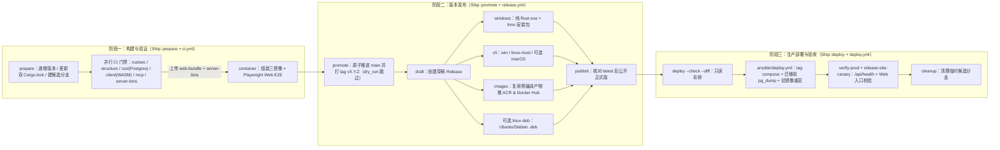

# 发版与构建(Release & build)

Mica 已切流至 **100% 全栈纯 Rust 架构**（L1 引擎 + L2 无头内核 + L3 `clients/mica_rust` 桌面/WebAssembly，零 Flutter / Dart / Android APK）。
GitHub Actions 使用官方 runner。正式发版由人在确认后手动触发一次，后续按 **构建与验证 → 版本发布 → 生产部署与验收** 三个阶段流水线自动接续；推送 `main`、tag 或 PR 均不会自动发版。

> **对外 SDK 发布走独立流程**：发布 `mica-board` / `mica-md`（crates.io）与 `mica-md`（npm，tag `mica-md-vX.Y.Z`）请见 [sdk-release.md](sdk-release.md)，不经过本页的 `Ship` / `Release` / `Deploy` 流水线。

---

## 入口与三阶段全景

**默认走托管路径**。在 [Actions → Ship](https://github.com/weironz/mica/actions/workflows/ship.yml) 选择 `main`（正式发版取消勾选 `dry_run`；`version` 留空自动递增补丁号，决定升 minor 时手填 `X.Y.Z`）：

```bash
gh workflow run ship.yml --repo weironz/mica --ref main -f dry_run=false
# 指定版本：
gh workflow run ship.yml --repo weironz/mica --ref main -f dry_run=false -f version=X.Y.Z
```



### 交付范围与平台边界

- **正式交付产物**：
  - **Windows 桌面安装包**：`Mica-Setup-X.Y.Z.exe` + `sha256-windows-installer.txt`（驱动桌面端应用内自动更新）
  - **容器镜像（同版本不可变 tag `vX.Y.Z`）**：`mica-api`、`mica-web`（纯 Rust WASM + Nginx）、`mica-cli`（备份 sidecar）同时推送至阿里云 ACR 与 Docker Hub
  - **`mica-cli` 二进制**：`windows-x64.exe`、`linux-x64`（静态 musl）、可选 `macos-arm64`（各自附 `sha256-*.txt`）
  - **可选 Linux 桌面包**：`Mica-X.Y.Z-linux-amd64.deb`（手动勾选 `build_linux_deb` 或变量 `MICA_BUILD_LINUX_DEB=true` 时产出）
- **停止维护说明**：Android 与 macOS 桌面安装包不再更新（原有 `0.14.x` Android 包可继续使用但无新功能）。

### `dry_run` 彩排与失败续跑

- **`dry_run` 默认开启**：仅运行**阶段一**完整 CI（含 Playwright E2E）及**阶段二**所有发布产物的试构建（不推送 `main`/tag、不建 Release、不推镜像、不部署生产），结束由 `cleanup` 回收临时候选分支。
- **失败续跑**：网络或 runner 抖动时直接在原运行点 **Re-run failed jobs**（失败的运行会保留候选分支）。若打 tag 前 `main` 已前进，重新从最新 `main` 触发；若 tag 已创建，修好外部问题后续跑原运行，无需重新提版。

---

## 阶段一：构建与验证（`Ship::prepare` + `ci.yml`）

阶段一的目标是在任何外部可见状态（`main`、tag、Release、生产节点）改变之前，在**临时候选分支**上完成全栈纯 Rust 构建、静态门禁、数据库测试与容器端到端验证，并产出供后续阶段直接复用的预编译二进制与 WASM 包：

1. **`prepare`（`scripts/release-candidate.sh prepare`）**：
   - 计算目标版本（未指定时取最新 `vX.Y.Z` 递增 patch），同步更新根 `Cargo.toml`、`clients/mica_rust/Cargo.toml`、两份 `Cargo.lock` 以及 `README.md` / `docs/ops/deploy.md` 的 `RELEASE=` 引脚，推送临时候选分支并输出 `sha`。
2. **并行门禁与构建（`.github/workflows/ci.yml`，`scope=full`）**：
   - **`rustsec`**：使用钉死版本的 `cargo-audit` 审计根 `Cargo.lock` 与 `clients/mica_rust/Cargo.lock`。
   - **`structure`**：执行 `check-ignored-sources.sh`、`check-migration-tracking.sh`、`test-migration-tracking.sh`、`check-file-size.sh`（单文件行数预算/硬上限检查）。
   - **`rust`**：启动 `postgres:18.6-alpine`，执行 `cargo fmt --all --check`、`cargo clippy --workspace --all-targets -- -D warnings`、应用迁移、运行带可达 Postgres 的全量测试（`cargo_receipt` 校验实际通过数，禁止静默跳过）、`mica-core --features store` 及 `mica-md` 示例。
   - **`client`**：安装 Linux GUI 依赖及 `wasm32-unknown-unknown` / `wasm-bindgen-cli` / `wasm-opt` / `brotli`，运行 `clients/mica_rust` 的 `clippy -D warnings`、全部单元与无头端到端测试（`cargo_receipt` 校验）、原生桌面构建、CSP 哈希一致检查（`test-web-csp-hashes.sh`）以及 `build-web-rust.sh`（含 4.0 MiB Brotli-11 预算检查），产出并上传 **`web-bundle-<sha>`**。
   - **`mcp`**：编译 `mica-cli` 并使用官方 `@modelcontextprotocol/inspector` 验证 `mica-cli mcp tools/list` schema 契约。
   - **`server-bins`**：在 `rust:<pin>-slim-bookworm` 容器内预编译适配运行环境的 glibc-2.36 `mica-api-server` 与 `mica-cli` 二进制，检查迁移文件原始 LF 字节，上传 **`server-bins-<sha>`**。
3. **容器全栈与浏览器端到端（`ci.yml::container`）**：
   - 直接下载阶段一产出的 **`web-bundle-<sha>`** 与 **`server-bins-<sha>`**，通过 `Dockerfile.{web,api,cli}`（后两者走 `runtime-prebuilt` target）构建三份 CI 镜像并拉起容器栈；
   - 运行 `scripts/web-entry-cache-check.sh http://127.0.0.1` 校验缓存头、WASM MIME 与 CSP；
   - 使用缓存的 Playwright Chromium 运行 `e2e/web_e2e.mjs` 全栈真实浏览器测试（涵盖登录、新建/编辑、共享、工作区设置、移动端触屏等流程）。

> 迁移 SQL 必须在工作区保持**原始 LF 字节**（`check-migration-bytes.sh` 在 CI 与镜像构建期强制校验），原因见 [0.13.67 故障记录](release-0.13.67-failure.md)。

---

## 阶段二：版本发布（`Ship::promote` + `release.yml`）

只有阶段一全部通过且 `dry_run=false` 时才推进对外版本状态：

1. **原子推进与打标（`Ship::promote`）**：
   - 核对 `main` 未在 CI 期间前进；若无冲突则将候选提交原子推进到 `main` 并推送不可变 tag `vX.Y.Z`（若期间 `main` 已变化则拒绝推进）。
2. **创建草稿并校验版本一致性（`release.yml::draft`）**：
   - 由 `release-version.sh` 统一解析版本并校验 `vX.Y.Z` tag 精确指向目标 `sha`；创建一个 **`draft: true`** 的 GitHub Release（所有子任务挂齐附件前对外不可见，`/releases/latest` 仍指向上一完整版本，保证 Windows 应用内更新器不会拉到半成品）。
3. **跨平台产物并行构建与镜像推送**：
   - **`windows`**：在 `windows-latest` 上执行 `test-installer-wait.ps1`、编译纯 Rust 桌面端 `clients/mica_rust`（`--bin mica-rust --release --locked`）、使用 Inno Setup 6（已预装则跳过安装）打 `Mica-Setup-X.Y.Z.exe` 并生成 `sha256-windows-installer.txt`，上传至草稿 Release。
   - **`cli`**：按 `release-cli-matrix.py` 在 Windows / Ubuntu(`x86_64-unknown-linux-musl` 静态链接) / 可选 macOS 上并行编译 `mica-cli` 与 `sha256-<os>.txt`，上传至草稿 Release。
   - **`images`**：直接复用阶段一传递过来的 `web_bundle_artifact` 与 `server_bins_artifact`（仅当脱离 `Ship` 单独触发 `Release` 时才触发容器/WASM 回退构建），以 `provenance: false`、`sbom: false` 同号构建并同时推送 `mica-api`、`mica-web`、`mica-cli` 到阿里云 ACR 与 Docker Hub。
   - **`linux-deb`（可选）**：勾选 `build_linux_deb` 或启用仓库变量 `MICA_BUILD_LINUX_DEB=true` 时，调用 `scripts/build-linux-deb.sh` 构建并挂载 `.deb` 与 `sha256-linux-desktop.txt`。
4. **公开版本（`release.yml::publish`）**：
   - 待 `windows`、`cli`、`images`、`linux-deb` 全部落定并核对 `releases/latest` 未被并发插队后，执行 `gh release edit vX.Y.Z --draft=false --latest` 将 Release 翻为正式公开版。
   - **独立公开产物验收（`.github/workflows/release-canary.yml`）**：支持手动调度或在需要独立验证已公开资产时运行 `scripts/release-canary.sh X.Y.Z`，在干净 `ubuntu-latest` 与 `windows-latest` 环境中下载公开的 `Mica-Setup-*.exe` / `mica-cli` / 可选 `.deb`，逐一核对 SHA-256、在一次性 runner 中验证前序版本的真实安装/覆盖升级、版本输出与首帧启动存活。

> ⚠️ 若 `publish` 阶段意外中断，草稿 Release 与全部已上传附件均安全保留，直接补跑以下命令即可公开：
> ```bash
> gh release edit vX.Y.Z --repo weironz/mica --draft=false --latest
> ```

---

## 阶段三：生产部署与验收（`Ship::deploy` + `deploy.yml`）

阶段二公开 Release 后，`Ship` 自动衔接阶段三部署生产（同样支持通过 [Actions → Deploy](https://github.com/weironz/mica/actions/workflows/deploy.yml) 或本地 `just deploy-prod X.Y.Z` 独立重放/回滚至任意已发布版本）：

1. **前置检查与隔离环境（`deploy.yml`）**：
   - `concurrency: deploy-prod`（排队执行、不取消在途部署，防止并发写坏节点 `.env`）。
   - 校验版本格式为 `X.Y.Z`；由 `Ship` 触发时校验 `require_latest: true`（拒绝把非最新测试版意外覆盖线上）。
   - 恢复 `ansible-core` + `community.docker` 缓存，并将 `DEPLOY_SSH_KEY` / `DEPLOY_KNOWN_HOSTS` 隔离写入 `$RUNNER_TEMP/deploy-ssh`（配合 `ControlMaster` + `ANSIBLE_PIPELINING=1`，`if: always()` 自动清理临时私钥）。
2. **强制先彩排、后真上**：
   - 每次部署**必先**执行 `scripts/deploy-prod.sh "$VERSION" --check --diff` 针对真实生产节点完成只读 dry-run（检查节点可达性、Postgres/RustFS 健康状态、还原点目录可写性及 compose/env diff），彩排通过后才正式运行 `scripts/deploy-prod.sh "$VERSION"`（手调 `Deploy` 时传 `-f check=true` 则彩排完即停）。
3. **幂等编排与防呆保障（`ansible/deploy.yml`）**：
   - **配置来源锁定**：`docker-compose.yml` 通过 `git show vX.Y.Z:deploy/docker-compose.yml` 严格从目标 tag 提取；`.env` 由 `ansible/host_vars/mica-prod.yml` 渲染（拒绝凭据键入库、拒绝删减节点已有配置键），节点 `.env.secrets` 仅人工维护、playbook 永不修改。
   - **迁移前内容校验还原点**：比对节点当前 `MICA_VERSION` 与目标 tag 间的 `migrations/` 变更，只要存在新 SQL 迁移（或历史无法确定）即在部署前通过 `set -o pipefail` 落盘 `pg_dump | gzip`，并使用 `awk` 同时校验 dump 结尾标记与核心数据表存在（不只依赖 `gzip -t`），失败立刻中止。
   - **只动应用面、不惊动数据面与共用网关**：数据面（`postgres` / `rustfs`）只检健康、不重建；只从阿里云 VPC 仓库 pull `api` / `web`（及已启用的 `backup` sidecar），`--no-deps` 重建并等待健康检查；普通 Mica 发版绝不改动或重启共享 Traefik（见 [traefik-working-set.md](traefik-working-set.md)）。
   - **失败自动回滚**：任一步失败自动复原节点 `.env` 中的旧 `MICA_VERSION` 并拉起上一版本容器。
4. **线上自动验收与候选清理**：
   - 部署完毕后 `scripts/deploy-prod.sh` 自动调用 `scripts/verify-prod.sh`（断言线上 `/api/health` 返回精确版本 `X.Y.Z`）与 `scripts/release-site-canary.sh`（拉取目标 tag 的 `web-entry-cache-check.sh`，核验线上 Web 入口缓存策略、WASM `application/wasm` MIME 与入口脚本可用性）。
   - 全部通过后，`Ship::cleanup` 删除阶段一创建的临时候选分支。
5. **人工收尾（机器不能替代的两件事）**：
   - **冒烟本版真实业务改动**（`verify-prod` 只验证版本号与静态入口，功能正确性需针对本版变更实测一次）。
   - **同步路线图**：将本版已完成的项从 [roadmap.md](../plans/roadmap.md) 整条移入 [roadmap-done.md](../plans/roadmap-done.md)（非硬门禁，随发版顺手维护）。

---

## 本地兜底发版与分步恢复（Actions 额度用完或故障时）

当 GitHub Actions 不可用时，**一台开启 Docker Desktop 的 Windows 或 Linux 主力机**即可运行等效本地发布链路：

```bash
# 0. 本地前置检查（一次性报出 gh API / Inno Setup / Docker 与双仓库登录 / 磁盘 / Postgres / tag 占用等问题）
just release-preflight X.Y.Z

# 1. 本地门禁（需本地 Postgres 运行，对应 ci.yml 检查项）
just ci              # 或 just ci rust / just ci client

# 2. 本地一条命令完整发布（preflight → release → push → artifacts → images → upload → publish）
just ship X.Y.Z      # 失败重跑会自动复用同一 commit 已产出的构建与镜像推送（REBUILD=1 强制重做）

# 或拆步执行：
just release X.Y.Z            # bump 版本 + 双 Cargo.lock + 门禁 + commit + tag（不推送）
git push origin main vX.Y.Z   # 推送标签与主分支
just release-artifacts X.Y.Z  # 构建本机能产出的产物 → dist/vX.Y.Z/（Windows 下有 Docker 会自动用 mica-cli-musl-builder 编静态 Linux CLI）
just release-images X.Y.Z     # 构建并推三个镜像到 ACR + Docker Hub
just release-upload X.Y.Z     # 创建或更新 draft Release 并上传附件
just release-publish X.Y.Z    # 逐项核对资产 digest 与 sha256-*.txt 一致后公开并设 latest
```

### 各端产物构建支持矩阵

| 产物 | 托管 CI（`release.yml`） | 本地机要求（`release-artifacts.sh`） |
| --- | --- | --- |
| `Mica-Setup-X.Y.Z.exe` + 校验和 | `windows-latest`（`windows` job） | Windows + Rust + Inno Setup 6 |
| `mica-cli-X.Y.Z-windows-x64.exe` | `windows-latest`（`cli` 矩阵） | Windows + Rust |
| `mica-cli-X.Y.Z-linux-x64`（静态 musl） | `ubuntu-latest`（`cli` 矩阵） | Linux 原生 `musl-tools` 或 Windows/macOS + Docker（缓存镜像 `mica-cli-musl-builder:<Rust 版本>`） |
| `mica-cli-X.Y.Z-macos-arm64`（可选） | `macos-latest`（`build_macos_cli=true`） | macOS（默认非必需，设 `REQUIRE_MACOS=1` 才强制） |
| `Mica-X.Y.Z-linux-amd64.deb`（可选） | `ubuntu-latest`（`build_linux_deb=true`） | Linux + GTK4/GStreamer 开发包（或容器化构建） |
| `mica-api` / `mica-web` / `mica-cli` 镜像 | `ubuntu-latest`（`images` 矩阵） | 任意运行 Docker 的主机 |

### 本地兜底部署（`just deploy-prod`）

- 与托管 `deploy.yml` 跑同一套 `scripts/deploy-prod.sh` + `ansible/deploy.yml`：
  ```bash
  just deploy-prod X.Y.Z --check --diff   # 先彩排
  just deploy-prod X.Y.Z                  # 真实部署并自动执行 verify-prod + release-site-canary
  ```
- **Windows 说明**：Ansible 不支持 Windows 作为原生控制端（`pipx install ansible-core` 能装但运行即报 `OSError: [WinError 87]`）。当本机没有可用 Linux/macOS Ansible 且 Docker Desktop 正在运行时，`scripts/deploy-prod.sh` 会自动切入 `alpine/ansible` 容器内完成部署。

---

## 核心把关清单与运维红线

### 机器替你把关的硬门禁

| 门禁 | 执行位置 |
| --- | --- |
| 双锁文件与版本号一致（根 `Cargo.toml`/`Cargo.lock` + `clients/mica_rust/Cargo.toml`/`Cargo.lock` + `README.md`/`deploy.md`） | `scripts/manifest-version.sh`、`scripts/release-check.sh`、`scripts/release-tree-check.sh` |
| Rust 工具链与 `rust-toolchain.toml` 一致；`md-wasm` 工具链匹配 | `scripts/release-check.sh`、`scripts/check-md-wasm-toolchain.sh` |
| Postgres DB 测试真运行（不可达即拒绝，禁静默跳过）；回执下限校验（`cargo_receipt`） | `scripts/release-check.sh`、`scripts/lib-receipt.sh`、`.github/workflows/ci.yml` |
| 代码结构行数预算、被 `.gitignore` 遮蔽源文件检查、已发布 SQL 迁移原始 LF 字节冻结 | `scripts/check-file-size.sh`、`scripts/check-ignored-sources.sh`、`scripts/test-migration-tracking.sh`、`scripts/check-migration-bytes.sh` |
| Web CSP 内联脚本 sha256 与双份 Nginx 配置一致；4.0 MiB Brotli-11 打包体积预算 | `scripts/test-web-csp-hashes.sh`、`scripts/build-web-rust.sh`、`scripts/web-entry-cache-check.sh` |
| Tag 与提交 SHA 精确绑定；先挂齐全部必需附件与 SHA-256 校验再公开并验证 `/releases/latest` | `.github/workflows/release.yml`、`scripts/release-publish.sh` |
| 安装包冒烟彻底隔离正式客户端与用户数据目录（`/MICASMOKE` + 独立 `APPDATA` + 按目录划分单实例锁） | `scripts/smoke-installer.ps1`、`scripts/release-canary.sh` |
| 带 SQL 迁移部署必落经 `pipefail` + 双标记校验的 `pg_dump` 还原点；失败自动回滚 `MICA_VERSION` | `ansible/deploy.yml` |

### 镜像、Compose 与节点配置规则

1. **三镜像同号 + 不可变 Tag**：`mica-api`、`mica-web` 与 `backup`（`mica-cli`）共同引用 `${MICA_VERSION:?}`，每次必须同号同推且使用不可变版本 tag（`vX.Y.Z`），严禁 `latest` 或滚动覆写（避免镜像加速器缓存漂移）。
2. **永远不要手改生产节点 `/data/mica/docker-compose.yaml` 或 `.env`**：每次部署由 `ansible/deploy.yml` 从目标 tag 覆盖下发 compose 并由 `ansible/host_vars/mica-prod.yml` 重新渲染非敏感 `.env`；在节点手工执行 compose 命令必须用 **`./dc`**（同时加载 `.env` 与 `.env.secrets`），不要裸跑 `docker compose`。
3. **`.env` 与 `.env.secrets` 职责分离**：21 项非敏感配置进 `host_vars`（含严禁密钥字段校验与严禁减少现有键检查），13 项凭据人工一次写入节点 `.env.secrets`（`600` 权限，Ansible 永不读写）。
4. **基础设施升级单独走**：变更 Postgres / RustFS 大版本不走应用发版流程，按 [upgrade-infra.md](upgrade-infra.md) 单独操作。

### CI Secrets 与 SSH Key 维护

| Secret | 用途与注意事项 |
| --- | --- |
| `ACR_USERNAME` / `ACR_PASSWORD` | 推送阿里云 ACR（使用镜像仓库密码或最小权限 RAM 子账号，不用主账号 AK/SK） |
| `DOCKERHUB_USERNAME` / `DOCKERHUB_TOKEN` | 推送 Docker Hub 备份镜像（PAT Read & Write） |
| `DEPLOY_SSH_KEY` | 部署私钥（node72 `authorized_keys` 带 `restrict` 禁 PTY 与端口转发，详见 [cd-plan.md](cd-plan.md) §4） |
| `DEPLOY_KNOWN_HOSTS` | 生产节点固定主机公钥（严禁部署期用 `ssh-keyscan` 盲信） |

轮换 `DEPLOY_SSH_KEY`（注意 `authorized_keys` 中选项与密钥类型之间是**空格**，多个选项之间才是逗号）：
```bash
ssh-keygen -t ed25519 -f ~/.ssh/mica-deploy-ci -N "" -C github-actions-deploy-mica
printf 'restrict %s\n' "$(cat ~/.ssh/mica-deploy-ci.pub)" \
  | ssh root@mica.cloudcele.com 'sed -i "/github-actions-deploy-mica/d" ~/.ssh/authorized_keys; cat >> ~/.ssh/authorized_keys'
gh secret set DEPLOY_SSH_KEY --repo weironz/mica < ~/.ssh/mica-deploy-ci
```

---

## 常见踩坑备忘

- **Windows Git Bash / `cygpath`**：`just` 的 shebang recipe（如 `deploy-prod`）在 PowerShell 下需要 `Git\usr\bin` 在 `PATH` 中，建议直接在 Git Bash 中执行 `just` 命令，或在 PowerShell 临时前置 `$env:PATH = "C:\Program Files\Git\usr\bin;$env:PATH"`。
- **WASM 工具链**：本机编译 `clients/mica_rust` 的 `wasm32-unknown-unknown` 需要 `clang`（供 `zstd-sys` 使用）、`wasm-bindgen-cli`（版本须精确匹配 `clients/mica_rust/Cargo.lock`）、`wasm-opt` 与 `brotli`。
- **Docker buildx 索引兼容**：本地 `docker build` 必须带 `--provenance=false --sbom=false`（CI 已禁用），否则生成的 OCI attestation 多 manifest 索引会导致部分镜像服务或 `docker load` 解析失败。
- **跨 await / 增量迁移嵌入**：新增数据库迁移文件后由 `crates/infra/build.rs` 自动感知触发重新编译；若在非标准路径打包可校验 `check-migration-tracking.sh`。

## 相关文档

- [部署与自托管运维指南](deploy.md)
- [SDK 发版流程（crates.io + npm）](sdk-release.md)
- [开发环境配置与换机重配](../dev/dev-environment.md)
- [CI Runner 架构与记录](ci-runners.md)
- [Traefik 工作集保护](traefik-working-set.md)
- [备份与容灾演练](backup.md)
